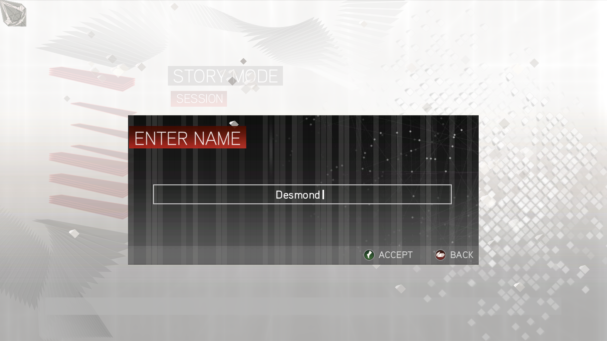
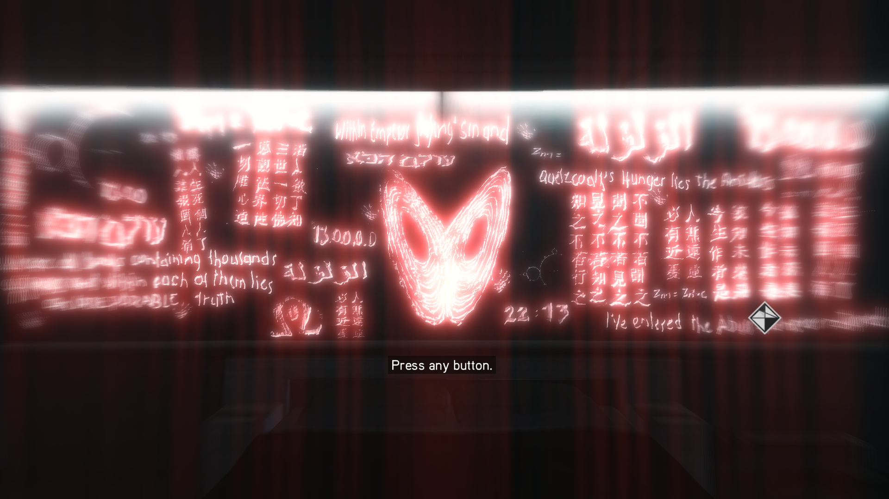
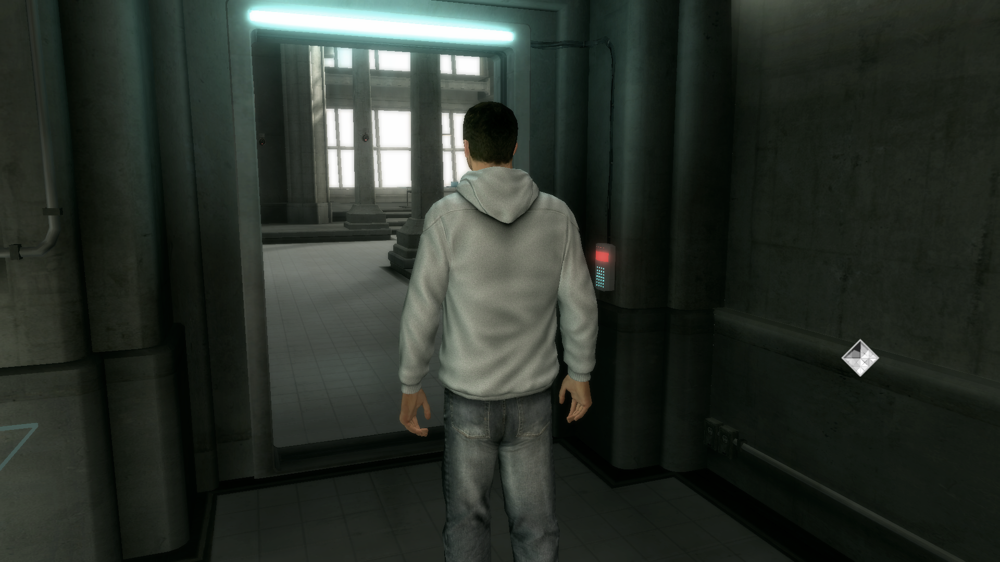
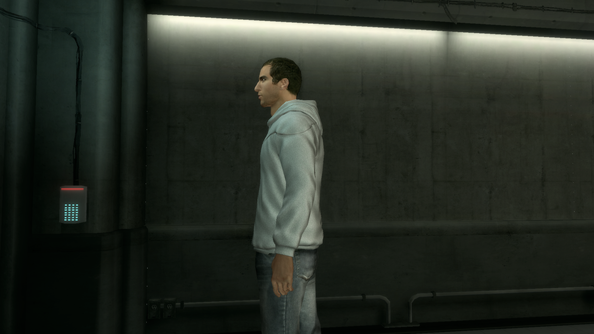
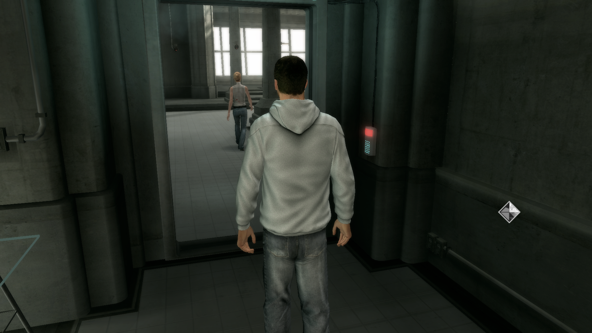
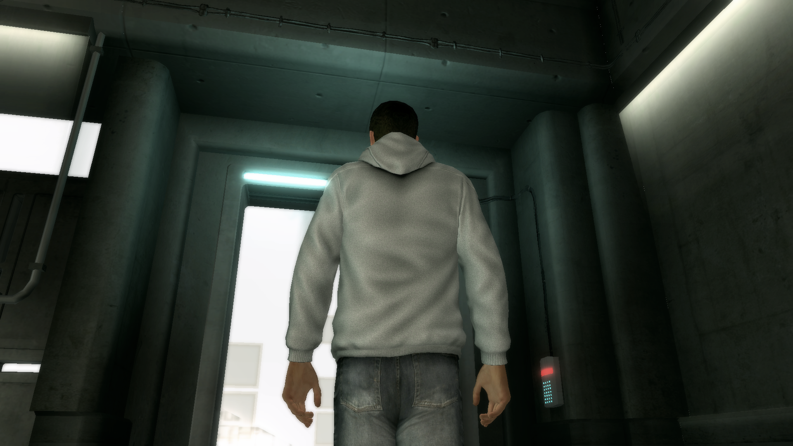

# Cracking Assassin's Creed II (Steam 33230) under Wine: a full writeup

**Status: not yet playable to a loaded level.** This document records how far the
effort got, what was measured, and what the next blocker actually is. The exact
command sequences and offsets are included inline.

```
title -> main menu -> STORY MODE -> profile name ("Desmond") -> Animus intro
      -> 3D Abstergo lab -> Animus descent -> Lucy Stillman cutscene
      -> [STALL]                                 <-- where we are
```

The renderer is real throughout: correct lighting, the Animus diamond, lab
geometry, NPCs, cinematic cameras. **Nothing in this writeup is a claim that a
level loaded.** Screenshots that were reached *by hand* are labelled as such and
prove only that the renderer works.

---

## 0. What the target is

| | |
|---|---|
| binary | `AssassinsCreedIIGame.exe`, 32-bit PE, ImageBase `0x400000`, **no ASLR** |
| size | 34,826,896 bytes |
| `.text` | file offset **== RVA**, so `VA = 0x400000 + file offset` |
| `.rdata` | VA `0x1CA5000` == file `0x18A5000` |
| DRM | SteamStub v3.1, then Ubisoft "Orbit"/OSI, then an in-game exit-42 gate |
| level data | 25 `DataPC*.forge` files, 3.9 GB, all present and verified complete |

---

## 1. Stage 1: getting past SteamStub

The exe ships with a SteamStub that self-modifies and CRCs itself. Hand-stepping
is impossible: at runtime it overwrites its own conditional jumps with
`FF FF FF FF`, invalid opcodes, so single-stepping raises SIGILL.

The stub's flow, traced through wine's relayer:

```
GetModuleHandleA("kernel32.dll")
  -> resolve its 34-entry API table
  -> HKLM\Software\Valve\Steve\ActiveProcess      [fails, no Steam]
  -> GetModuleHandleA("steamclient.dll")          [fails]
  -> ShellExecute(steam://run/33230//)  ->  exit 53
```

The first idea was to fake the whole handshake: build a `steamclient.dll` and
create the `Local\SteamStart_SharedMem*` event and file mapping the stub looks
for. That got the stub from gate `W` to gate `B` and then crashed wine's *loader*
with SIGSEGV before the entry point even ran. Building the shared memory objects
inside `DllMain` was what destabilised it.

The fix was to stop emulating Steam and **remove the gate from the payload
instead**:

1. decode the stub header. It uses chained XOR, magic `0xC0DEC0DF`, and AppID
   `0x81CE` = 33230.
2. extract the second-stage payload at `.bind+0x1570` and TEA-decrypt it. The key
   is at `hdr+0x98`; the seeds are chained over the *ciphertext* for 32 rounds with
   `delta = -0x9E3779B9`.
3. patch the payload: it is a valid PE with its own entry point:
   ```
   RVA 0x66C3: 75 0B            -> EB 0B            (jne -> jmp)
   RVA 0x66D0: 57 E8 FA F8 FF FF -> B0 30 90 90 90 90
                                        (call SteamAPI_Init gate -> mov al,'0')
   ```
4. re-encrypt with the inverse TEA and splice it back into a **copy** of the exe
5. patch the stub's own CRC comparison so it does not reject the modified payload:
   ```
   RVA 0x2170B73: 74 0A -> EB 0A
   ```
6. supply a minimal `binkw32.dll` proxy, because the game imports it statically

The result, watched by `.text` entropy:

```
8.0000 (packed)  ->  6.3188  ->  6.4539 (stable, all 6307 pages)
```

Original entry point `0x2170310`, real OEP `0x12D7F6B`. The original artifacts
were never touched; everything is derived from them.

**Lesson that mattered twice:** in-memory `VirtualProtect` patching of the stub
races wine's loader and crashes before the EP. Patching the *file* works, because
the stub re-reads its own pages.

---

## 2. Stage 2: the first real window

The unpacking script writes the decrypted `.text` back into the raw section and
repoints the entry point at the OEP. Under wine:

```
the loader resolves all imports (d3d9 -> wined3d/opengl, user32, ws2_32...)
the game's OWN decrypted code runs from the OEP
it reaches the game's own Steam check and exits with code 42, which is 0x2A
```

Exit 42 is the same gate the stub used to raise, only now it is raised by the
game's own code. Which is the cue for stage 3.



---

## 3. Stage 3: the Ubisoft Orbit layer

Traced through the registry and the loader:

```
HKLM\SOFTWARE\[Wow6432Node]\Ubisoft\Launcher -> InstallDir
  -> sprintf(buf, "%s\ubiorbitapi_r2.dll")
  -> 22 MgOrbit* exports resolved with GetProcAddress
  -> services object = new(0x60), cached in the global VA 0x22119a4
  -> gate at game+0x10dbc0 = `return [services+4]`
  -> on false: push 0x2a; call 0x109c840  ==  exit 42
```

A hand-built 32-bit PE stub DLL replaces `ubiorbitapi_r2.dll`. It is generated by a
small custom stub builder and a byte-level PE assembler built on keystone, with no
compiler. It logs every call to a text file as a tag plus 16 raw stack bytes plus
the live OSI state.

Working configuration: registry keys for `InstallDir` and
`HKLM\SOFTWARE\Ubisoft\Assassin's Creed II` -> `Language` = `English`, plus small
proxy DLLs for `XINPUT1_3.dll` and `d3dx9_42.dll`.

Result: **exit 0**, and on a native Windows 11 VM as well as under wine.

### Traps from this stage

* `CreateThread` from `DllMain` **deadlocks** on the loader lock, and the game
  hangs with zero logging. Spawn lazily from the first export call.
* `CreateThread`'s start address is the **3rd** argument, not the 2nd.
* keystone mis-encodes absolute `call`; emit `e8 rel32` by hand.
* Hooking `MessageBoxW` through the IAT makes the game exit 42 *immediately*,
  because the dialog is part of the retry path, not the failure.

---

## 4. Stage 4: the menu, with no save slots

The Orbit stub satisfied enough of the API for the game to reach its own menus.
The gate turned out to be **three modal "lost connection" raisers**, not the OSI
state machine and not the savegame record container. Both of those were
investigated in detail and disproved.

The fix was one patch at each entry point: replace the `void __thiscall`
prologue `55 8b ec` with `c3`, a bare `ret`. This suppressed:

```
Game.LostConnection.AccountSharing
Game.Startup.AwaitingFirstOsiConnection
Game.LostConnection.Resume / ResumeLastSavegame
```

After that the driver can walk
`title -> main menu -> STORY MODE -> profile name -> Animus intro` on its own.

### The automation, which was most of the work

Getting the game driven unattended means driving a 3D application by reading its
window with XGetImage. Everything below is a mistake that cost real time:

**Scene detection by image statistics does not work.** Three versions, three
different failures:

* comparing rounded means exactly: the title screen's animated background moves
  the mean by several counts every sample, so "the image has been still" never
  becomes true and the run sits on `PRESS ENTER` forever;
* bucketing the mean coarsely: the splash, the title and the profile screen all
  land in one bucket, so a per-scene budget never resets;
* a threshold of `MAD 2.0`: same problem, the animated frames reset the budget.

What works is a **calibrated threshold on pixel difference**. Measured over a
full run: p50 = 0.97, p90 = 40.8, p99 = 128. Real cuts score 40+; animation
wobbles to 4–20. The driver uses 15, the stimulus sweeper uses 30.

| run | what happened |
|---|---|
| threshold 2.0 | title screen counted as a new scene every frame, all 80 presses burned before a key ever reached the game |
| no `set_input_focus` | 80 presses, zero reaction; XTEST delivers to whatever has focus |
| focus restored, patched error handler | title -> main menu -> STORY MODE -> profile name -> Animus -> **lab, in 14 presses** |

**python-xlib 3.14 crashes replaying any X error.** `parse_error_response`
reads `e.sequence_number`, which none of its error classes define, so a single
`BadRRMode` poisons every later `flush()`. Patch it to return `None` on
`AttributeError`.

**`DISPLAY` is not always `:0`.** On 2026-10-15 the session was briefly niri +
Xwayland on `:2`, and every tool that hardcoded `:0` silently lost the window.
All tools now read `$DISPLAY`.



---

## 5. Stage 5: the 3D lab



The lab reads like a playable third-person scene. It is not: it is a scripted
cinematic. This took three increasingly careful measurements to establish.

**Attempt 1: the key sweep.** Hold each candidate for 3 s and report how many
pixels changed over three regions: the character body, frame centre, and whole
frame.

```
keys              body  centre   frame   verdict
w                 0.00    0.00    0.00   no effect
q                 0.00    0.00    0.00   no effect
down              0.00    0.00    0.00   no effect
KP_2              0.00    0.00    0.00   no effect
KP_4              4.74    1.78    1.19   slight
e                 3.40    1.29    0.87   slight
```

Best case is 4.74 grey levels on a 0–255 scale, about 1.9 %.

**Attempt 2: realise the measurement was invalid.** In the stuck scenes the
window repaints about once every three seconds:

```
  +  2.0s  frame MAD =  1.269
  +  4.0s  frame MAD =  0.000   <-- FROZEN
  +  6.0s  frame MAD =  0.691
  +  8.0s  frame MAD =  1.367

1/4 consecutive identical frames
```

A `0.00` from a key sweep means "nothing redrew", not "the key did nothing". The
first check should always be whether the window is repainting at all.

**Attempt 3: the adaptive sweep with a control.** The sweep holds a key, waits for
a real repaint, estimates displacement by SSD alignment over a `(dx, dy)` search,
remembers the winner, and leads with it next iteration.

Without a control this is actively misleading:

```
=== iteration 1 ===
  w       shift=( -8,-26) magnitude= 27px  align gain= 20.5%   <== MOVES THE PLAYER
  a       shift=( -8,-26) magnitude= 27px  align gain= 20.1%   <== MOVES THE PLAYER
  s       shift=(+12, +9) magnitude= 15px  align gain= 18.5%   <== MOVES THE PLAYER
  d       shift=(-12, -2) magnitude= 12px  align gain=  8.3%   <== MOVES THE PLAYER
```

*Every* key scores ~27px. With a no-keypress control the same experiment reports:

```
control (no key): shift<=17px  gain<=17.5%   <- a key must beat both to count
```

i.e. the metric is measuring the scene's own animation, and no key clears the
floor.

The independent check settles it. After a 16-step navigation pipeline of
`up`/`right`/`left` holds plus `return`/`space`/`e`:

```
nav_00 vs nav_15 (after up/right/left/return/space holds):
  MAD = 1.495
  character region only: MAD = 6.055
```

The screenshots show the character in a pixel-identical position and pose. That
is idle sway.

**Do not spend more time looking for the walk binding.** The lab leaves on its
own schedule, and no input accelerates it. This was re-confirmed with a stimulus
sweep that cycles Return/space/Escape/e/f/q/Tab, all four arrows, both mouse
buttons and mouse motion.



---

## 6. Stage 6: saves exist, nothing loads

With the Orbit stub's `GetSavegameList` completion firing, the game takes a new
profile and produces save slots. But nothing is *written*: `Documents`, the
registry and any save directory stay empty after a full session.

Measured cause: the game calls `GetSavegameWriter` and then, **only if the
completion hands it a non-NULL writer handle**, calls `WriterSetName/Write/Close`,
which call the exports **directly**, not through a vtable. The stub never fires
the writer completion, the handle stays NULL, and the whole block at VA `0x42B166`
is skipped. That is why `E13..E17` never appear in the log:

```
28640 E06   MgOrbitdllUpdate      (the only thing during the stall)
    9 E05   GetSavegameList       (FIRED)
    9 E20   SaveGameIn            (never fired)
    7 E03   GetSavegameReader      (never fired)
   20 E07   GetRequestUniqueId
```

Then the real blocker appears: **after the Lucy Stillman cutscene the screen goes
white and stays there.**




---

## 7. Stage 7: diagnosing the white screen

### What it is not

| hypothesis | verdict |
|---|---|
| slow loading of level data | **no.** `read_bytes` delta is 0 KB over 30 s; no `.forge` mapping ever gains a resident page |
| missing or truncated assets | **no.** all 25 `DataPC*.forge` present and verified; `DataPC_Altair_Memory.forge` is **never opened**, so the block precedes any file access |
| online config fetch | **no.** `strace` shows zero `connect()` calls, no external addresses at all |
| Bink video | **no.** the 2.5 KB `binkw32.dll` stub's `BinkOpen` failure path is handled cleanly, no `.bik` files exist, and `BinkNextFrame`/`BinkDoFrame` have **zero** call sites in the exe |
| DLC / entitlement gate | **no.** no such string or code exists in the binary |
| `MissionManager::Update` | **no.** straight-line, no loops |
| a *third* `SwitchToThread` spin | **no.** exactly two exist in 25 MB of `.text` |

### The tool that finally worked

Every register/stack method fails on a WOW64 thread under this wine build:

* `PTRACE_GETREGS` returns the outer 64-bit layout for a compat task, and
  `GETREGSET` does no better;
* `/proc/PID/task/TID/syscall` prints `running` while the task spins in user
  space, so there is no SP or PC to sample;
* `/proc/PID/task/TID/arch_status`, which would give the 32-bit EIP outright,
  **does not exist** on this kernel;
* `perf --call-graph dwarf` bottoms out at `start_thread`; the unwinder cannot
  cross from the 64-bit WOW64 shims back into 32-bit frames;
* `/proc/PID/mem` cannot see the 32-bit ImageBase at all.

But the CPU's **last-branch records** hold real 32-bit instruction pointers:

```sh
# set PID to the game's process id
perf record -q -F 199 -g --call-graph lbr -p "$PID" -o lbr.data
# aggregate lbr.data into call stacks
```

`perf script` prints each chain **innermost first**, 20–33 entries per sample,
already tagged with the module.

### The stack

TaskThread1's stack is identical on every one of ~3900 samples, 22 frames deep:

```
innermost   0x1605CAD  call eax                     <- hot site, 10 % of samples
            0x1604E25  call [0x21D1C30 + tag*4]     <- opcode dispatch
            0x16A3163  call 0x1604de0               <- for each element in a group
            0x16A33D2  (one of 0x16A3392/0x16A33D2/0x16A369A/0x16A3714)
            0x4204AB   job runner
            0x14F4B20
            0x14C0C79 <- 0x14C0DC6 <- 0x14C1120 <- 0x14C1E93 <- 0x14C2668
            0x4204CD   task driver (lock xadd on [obj+0x2C])
            0x14F4B20
outermost   0x16A3460  wait-all / SwitchToThread x 9
```

Decoded:

* **`0x1604DE0` is a bytecode interpreter.** Each record is
  `{uint32 tag; uint16 len}` and 8 more bytes; it advances by `len + 8`, looks up
  `*(0x21D1C30 + tag*4)` and calls it, until it reaches the end pointer.
* The dispatch table at VA `0x21D1C30` is **populated in the file**: 29 opcodes,
  all in `0x1604E50`–`0x1606040`:

  ```
  tag   0 -> 0x01605b00      tag  11 -> 0x01605bf0
  tag   1 -> 0x01605b30      tag  12 -> 0x01605c20
  ...                       ...
  tag  14 -> 0x01605c80      tag  26 -> 0x01604e50
  tag  19 -> 0x01605de0      (self-dispatch: the interpreter itself)
  ```
* `0x16A3163`'s loop iterates a `0x4c`-stride array, one interpreter run per
  element, the same element-group container the readiness wait polls.
* `0x1605C80` pushes six fields of its argument and calls `[[vtable+0x148]]`
  for **tag 14**, returning `record + 0x18`.

So the stall is inside a **cutscene script interpreter**, not a wait on another
thread, I/O, the OSI machine, Orbit, or the network. And the game never opens the
next level's forge because this interpreter never finishes the script it is
already running.

### What the interpreter actually is

The dispatch table at VA `0x21D1C30` is **in the file**: 29 opcodes, each a thin
wrapper that pushes fields of the record and calls one virtual slot:

```
tag  0 -> 0x1605B00  slot +0x0E4     tag 14 -> 0x1605C80  slot +0x148  <-- hot
tag  1 -> 0x1605B30  slot +0x114     tag 19 -> 0x1605DE0  slot +0x094  (nested script)
tag 13 -> 0x1605C50  slot +0x144     tag 26..28 -> 0x1604E50/E70/E90
```

Adding wine's own `WINEDEBUG=+d3d` trace shows what the hot opcode's slot points
at, and the answer is **D3D9**:

```
   77bbf21f  wined3d.dll                 <- innermost, from LBR
   77cb6036  wined3d.dll
   792b65b8  wine-d3d9.dll
    1605cad  AssassinsCreedIIGame.exe
    1604e25  AssassinsCreedIIGame.exe
    16a3163  AssassinsCreedIIGame.exe
```

Split by thread, the trace at the stall:

```
thread 0138  TaskThread1, the engine worker:
    3937  wined3d_stateblock_set_sampler_state
    2770  wined3d_stateblock_set_render_state
    2139  wined3d_device_set_ps_consts_f
    1898  wined3d_device_set_vs_consts_f
    1652  wined3d_cs_queue_submit
thread 0170  wined3d_cs, the GL command stream:
    3123  wined3d_cs_execute_next
     600  wined3d_context_gl_enter / 599 wined3d_context_gl_release
```

and the draw being issued is `index_count 6, start_idx 0`, a **fullscreen quad**,
with `wined3d_context_gl_acquire` and `wined3d_texture_load_location` resolving
to the same texture every time.

So the "interpreter" is the engine's **render/present loop**, redrawing the Animus
loading screen over and over while it waits for the next level to become ready.
Nothing ever flips an element to "ready". That is the whole blocker: not the OSI
machine, not Orbit, not a missing file, not a GPU stall.

> `WINEDEBUG=+d3d` is expensive: about 6 GB of text in 10 minutes. It filled
> `/tmp`, a 7.7 GB tmpfs, and writes began failing mid-run. Use a wrapper that
> writes the trace to a non-temporary location and keeps only the last window.

---

## 8. Where the next session should start

The interpreter's handler is the thing to instrument. Concretely:

1. **Tag 14**, handler `0x1605C80`, virtual slot `[[vtable+0x148]]`. Identify the
   concrete implementation of that slot; that is where ~10 % of TaskThread1's
   samples land.
2. **Find the producer for the readiness poll.** `0x16A3460` waits on the element
   container at `[this+0x2C40]`; nothing ever marks an element ready. Opcode 19,
   `0x1605DE0`, is a nested script, and opcodes 26-28 at `0x1604E50/E70/E90`,
   whose handlers use `call edx`, are the entry points most likely to submit the
   level load; check what guards them.
3. `0x14C2600` walks `[obj+8]` for `*(uint16*)([obj+0xe]) & 0x3fff` items calling
   `0x14C1540` on each and then sets `[obj] = 1`. If `0x14C1540` never marks items
   done, the `while eax < esi` condition is permanent.

Reproducibility: the build script can rebuild and verify every variant, and the
optional patch groups are toggled by environment variables. Pristine game files
are never modified.




---

## 9. Tooling

The work used five kinds of tools, all built for this target:

| tool | purpose |
|---|---|
| unpacker | decode the SteamStub header, decrypt the payload, and rebuild the PE |
| Orbit stub | generate a 32-bit DLL that satisfies the Ubisoft API and log its calls |
| automation driver | find the game window, synthesize input, and detect scene changes |
| profiler | aggregate perf LBR records into call stacks and sample thread state |
| binary scanner | find every `call`/`jmp rel32` that targets a given virtual address |
